# LocoLab Terrains

Custom IsaacLab terrain generators used by LocoLab.  The package is split by
terrain representation:

- `locolab_hf_terrains.py`: height-field terrain functions.
- `locolab_hf_terrains_cfg.py`: height-field terrain config classes.
- `locolab_mesh_terrains.py`: direct `trimesh` terrain functions.
- `locolab_mesh_terrains_cfg.py`: mesh terrain config classes.

`__init__.py` exports concrete `*TerrainCfg` classes for use by training terrain
configs.

## Preview

Run from the repository root with the IsaacLab Python environment (no IsaacSim
app, display, or additional rendering packages required):

```bash
/mnt/uv_envs/isaaclab_uv_envs/IsaacLab-3.0/.venv/bin/python3 \
  source/locolab/locolab/utils/terrains/locolab_terrains/preview/preview_locolab_terrains.py
```

Every terrain uses the same pipeline:

```python
meshes, origin = cfg.function(difficulty, cfg)
mesh = trimesh.util.concatenate(meshes)
render_mesh(mesh, output_path, title, view="3d")
```

The script calls the real terrain generators without preview substitutes. Both
height-field and mesh terrains use CPU ray casting against the generated
triangles, with nearest-surface visibility and equal XYZ scale. The default is
an orthographic 3D view. Colors show the visible surface height in meters, with
lighting to distinguish face orientation. No hidden edges or artificial ground
planes are added.

Representative configs live in `preview/preview_locolab_terrains_cfg.py`, separate
from training configs. Defaults are difficulty `0.5`, seed `7`, and size `8 × 8 m`.
The script writes one PNG per terrain and an `index.html` gallery to
`preview/terrain_previews/`, overwrites matching images, and updates the table
below. Newly exported terrain cfgs must have a preview case.

To render **all** terrains from above, pass `--view top`. To compare difficulties
without overwriting the README images, use a separate output directory:

```bash
# Run in the preview directory with the same Python environment.
python preview_locolab_terrains.py --view top --out /tmp/terrain-top --no-readme-update
python preview_locolab_terrains.py --difficulties 0 0.5 1 --out /tmp/terrain-levels --no-readme-update
```

## Adding Terrain

1. Add the terrain generation function to `locolab_hf_terrains.py` or
   `locolab_mesh_terrains.py`.
2. Add the matching `*TerrainCfg` class to the corresponding `*_cfg.py` file.
3. Export the cfg class from `__init__.py`.
4. Add representative preview parameters to
   `preview/preview_locolab_terrains_cfg.py`.
5. Run `python preview_locolab_terrains.py` and check the generated image.

## Existing Terrain Previews

<!-- BEGIN_AUTO_PREVIEWS -->

This section is generated by `preview/preview_locolab_terrains.py`.

| Terrain | Preview |
| --- | --- |
| `HfDiscreteObstaclesTerrainCfg` | 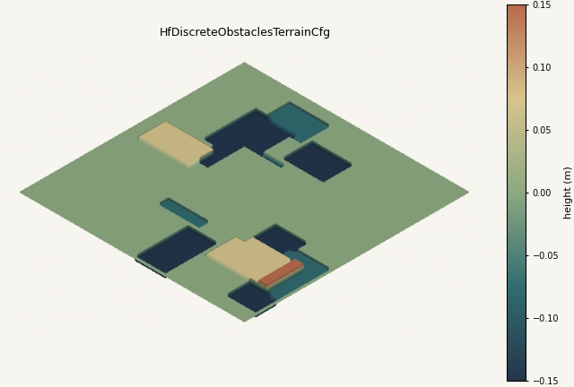 |
| `HfDoubleGapTerrainCfg` | 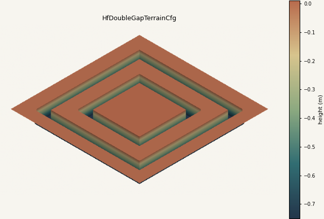 |
| `HfFlatRoughTerrainCfg` | 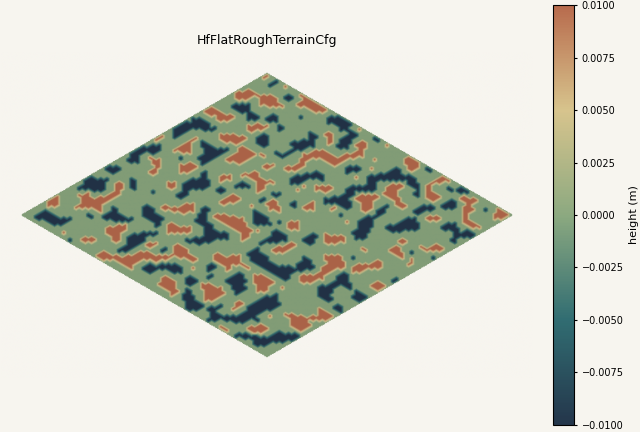 |
| `HfGapTerrainCfg` | 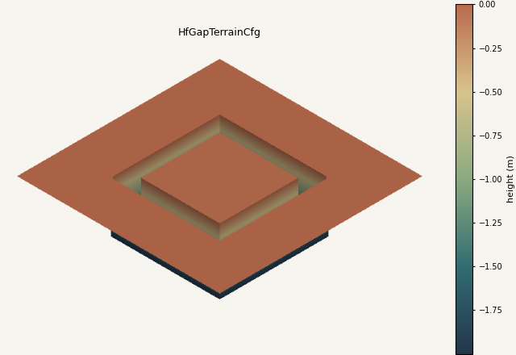 |
| `HfHurdleTerrainCfg` | 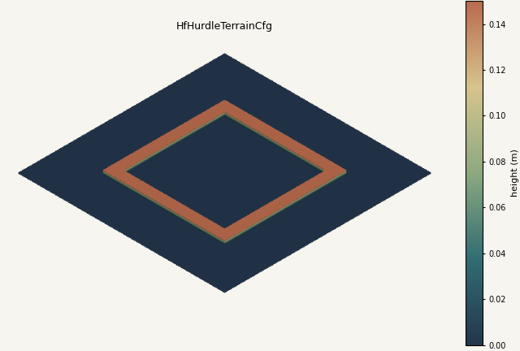 |
| `HfInvertedPyramidSlopedRoughTerrainCfg` | 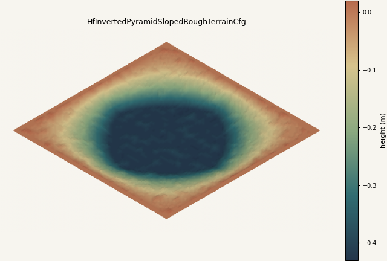 |
| `HfInvertedPyramidStairsTerrainCfg` | 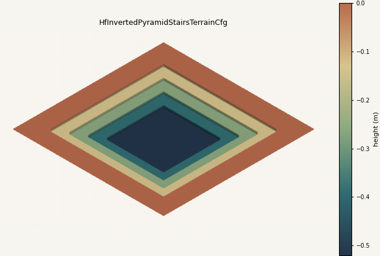 |
| `HfPyramidSlopedRoughTerrainCfg` | 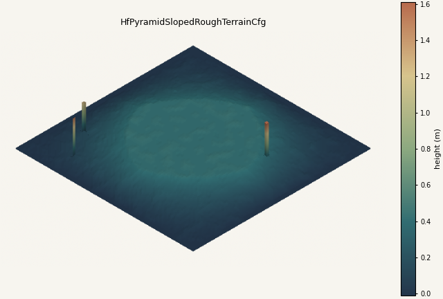 |
| `HfPyramidStairsTerrainCfg` | 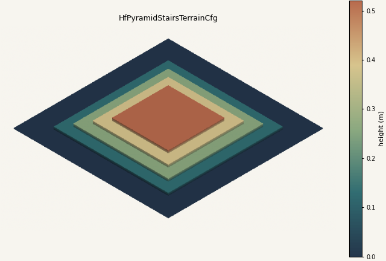 |
| `HfStraightGapTerrainCfg` | 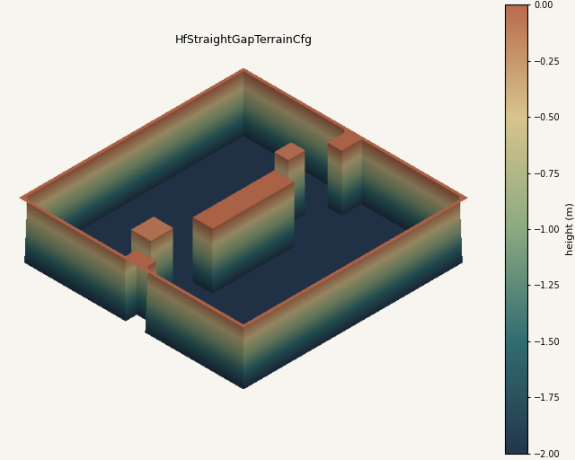 |
| `MeshCircularDoorsTerrainCfg` | 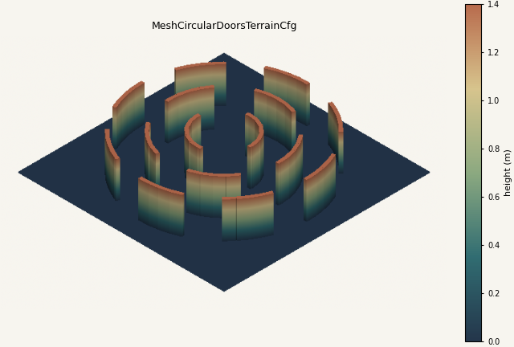 |
| `MeshCorridorTerrainCfg` | 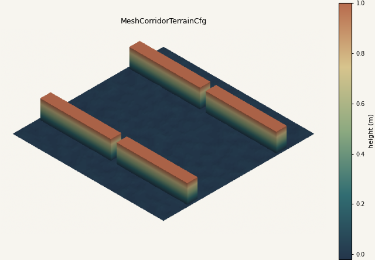 |
| `MeshDiverseStairsTerrainCfg` | 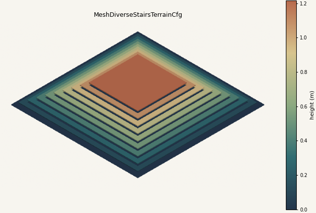 |
| `MeshHexSteppingStonesTerrainCfg` | 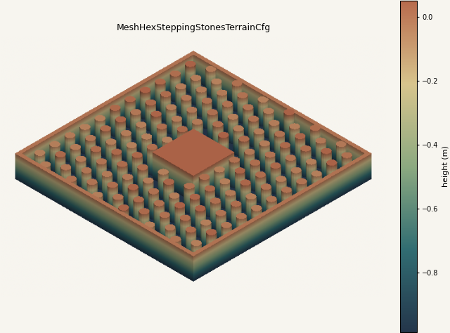 |
| `MeshHurdleTerrainCfg` | 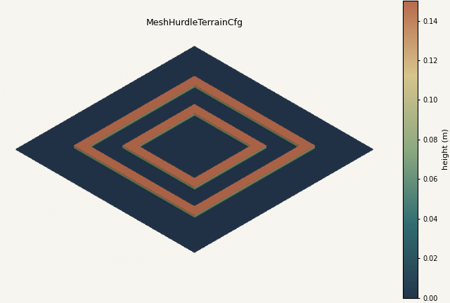 |
| `MeshInvertedDiverseStairsTerrainCfg` | 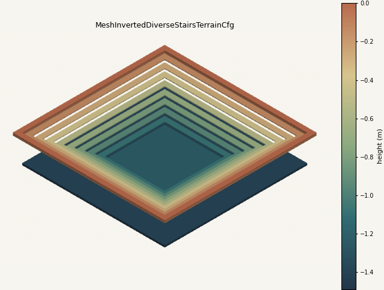 |
| `MeshInvertedPyramidStairsTerrainCfg` | 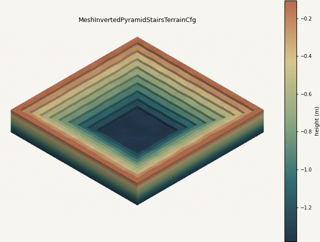 |
| `MeshInvertedStraightStairsTerrainCfg` | 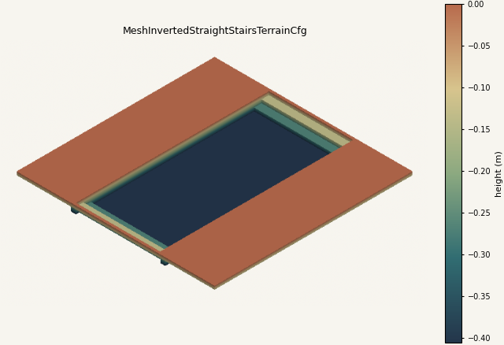 |
| `MeshMazeTerrainCfg` | 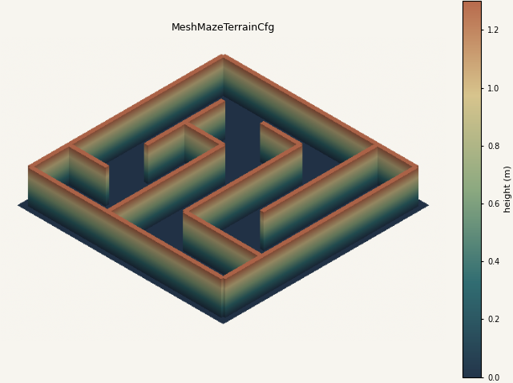 |
| `MeshPillarForestTerrainCfg` | 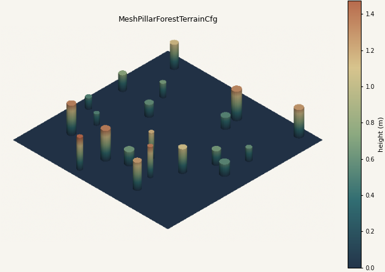 |
| `MeshPyramidStairsTerrainCfg` | 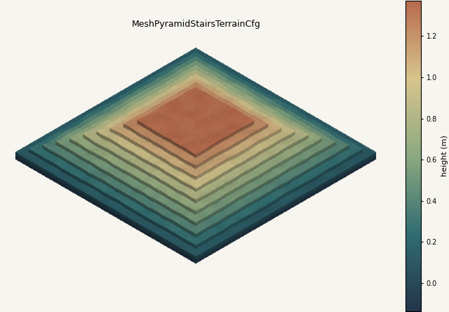 |
| `MeshRandomCeilingObstaclesTerrainCfg` | 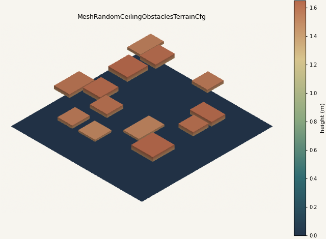 |
| `MeshRepeatedBoxesTerrainCfg` | 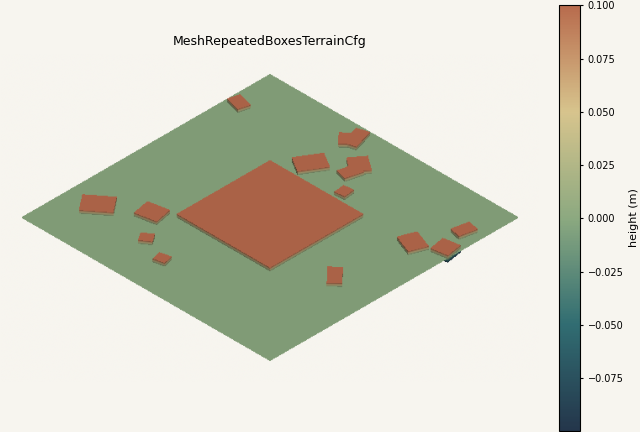 |
| `MeshRingPlatformsTerrainCfg` | 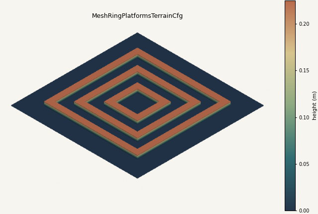 |
| `MeshStraightClimbTerrainCfg` | 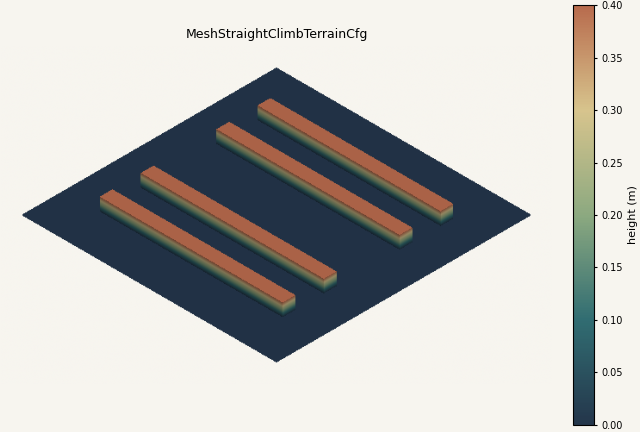 |
| `MeshStraightGapTerrainCfg` | 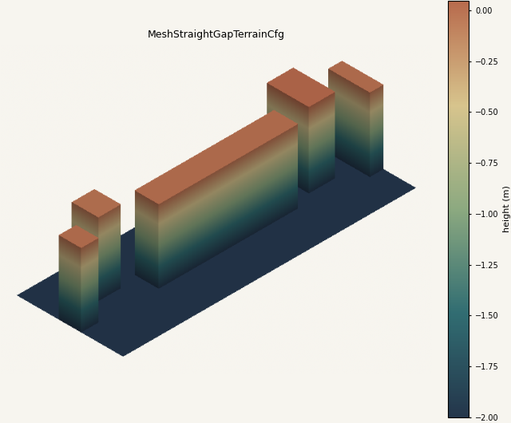 |
| `MeshStraightStairsTerrainCfg` | 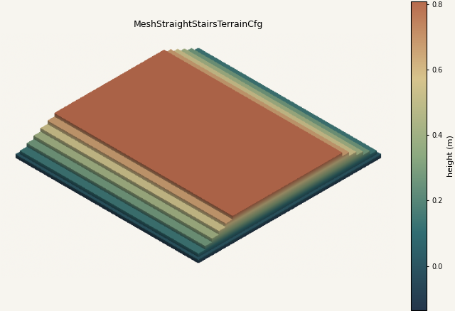 |

<!-- END_AUTO_PREVIEWS -->
